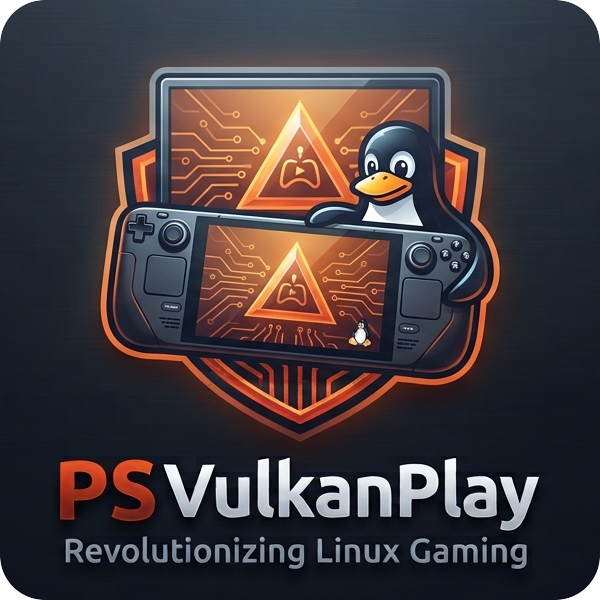

<p align="center">
  
</p>

# PS VulkanPlay

An open-source PlayStation Remote Play client for Linux: play your PS5 or PS4 from your desktop, laptop or
handheld. It is written from the ground up around a Vulkan renderer, with a small install and a couch-friendly
interface as goals.

## Status

Early development: there is no release yet. What exists so far:

- an app (`ps-vulkanplay` with nothing after it): your consoles as cards with Play and Wake, adding a console
  step by step (signing in with PSN gives it your account, so there is no account ID to look up), settings
  for everything a session can do, a choice of looks, and the connected controller with its battery at the
  bottom of the window. A controller moves through it as well as a pointer does: the direction buttons or the
  left stick, accept and back, the shoulder buttons for its pages, and keys on the page for a console's PIN
- finding consoles on the network, waking them from rest mode and registering with them
  (`ps-vulkanplay --help` lists the commands)
- taking over the consoles already registered in Chiaki or chiaki-ng (`ps-vulkanplay import`)
- playing: `ps-vulkanplay play CONSOLE` shows the console's picture in a window, plays its sound and sends
  what a controller does (buttons, sticks, triggers, touchpad, motion). The picture keeps going over lost
  frames and is shown evenly; the sound bridges short stalls of the network, and a cushion of delay can be
  asked for that hides the short pauses of a wireless network. `--wake` wakes a resting console first
- a DualSense on USB gets what a PS5 sends for it: haptics on the controller's own sound device, the effects
  of its adaptive triggers, the light bar's color; other controllers get rumble. Pictures are decoded in
  software for now; the microphone, the controller's speaker and HDR output are not there yet
- a connection check that counts, keeps or decodes what a console sends (`ps-vulkanplay session`)

Releases will appear on the Releases page when there is something to play.

## Building from source

You need a C++23 compiler (GCC 13 or Clang 17, or later), CMake 3.25 or later, Ninja, pkg-config, SDL 3.2 or
later, FFmpeg 7 or later (libavcodec), Opus, OpenSSL 3 or later, the Vulkan headers and loader, and glslang to
compile the shaders. With the PulseAudio client library (which PipeWire serves as well) the program also sets
the volume of a controller's haptics; without it, it builds the same less that. The app is a .NET program
of its own (`app/`) that runs the stream program: it needs the .NET 10 SDK, and the stream program builds
and plays without it.

| Distribution | Packages |
|---|---|
| Arch Linux | `base-devel cmake ninja openssl ffmpeg opus libpulse sdl3 vulkan-headers vulkan-icd-loader glslang` |
| Debian 13 | `g++ cmake ninja-build pkg-config libssl-dev libavcodec-dev libavutil-dev libopus-dev libpulse-dev libsdl3-dev libvulkan-dev glslang-tools` |
| Alpine Linux | `build-base cmake samurai pkgconf openssl-dev ffmpeg-dev opus-dev pulseaudio-dev sdl3-dev vulkan-headers vulkan-loader-dev glslang` |

```sh
cmake -S . -B build -G Ninja
cmake --build build
./build/ps-vulkanplay play CONSOLE

dotnet build app/PSVulkanPlay -c Release      # the app; put its output in a folder "app" beside ps-vulkanplay
```

`tools/build.sh` followed by `tools/build-app.sh` does both and leaves the program and the app in `bin/`.

The same build runs on glibc and on musl; both are built and started on every change.

## License

PS VulkanPlay is free software under the [GNU Affero General Public License, version 3](LICENSE).

This project is not affiliated with, endorsed or certified by Sony Interactive Entertainment. PlayStation, PS5
and PS4 are trademarks of Sony Interactive Entertainment Inc.

## Credits

PS VulkanPlay exists because of the people who worked out how Remote Play talks and shared it as free software:

- [chiaki-ng](https://github.com/chiaki-ng/chiaki-ng), which began as chiaki4deck, by Street Pea and its
  contributors: the client this project sets out to follow, and the reference our protocol code is tested
  against.
- [Chiaki](https://git.sr.ht/~thestr4ng3r/chiaki) by Florian Märkl and its contributors: the original
  open-source Remote Play client, where that research started.

The code here is our own; see [NOTICE](NOTICE) for how the two projects are used.
